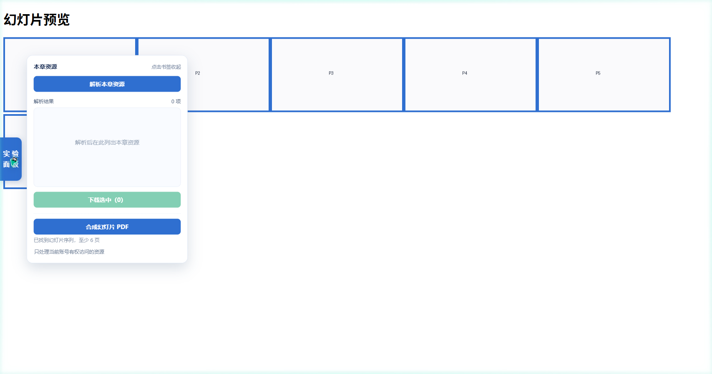
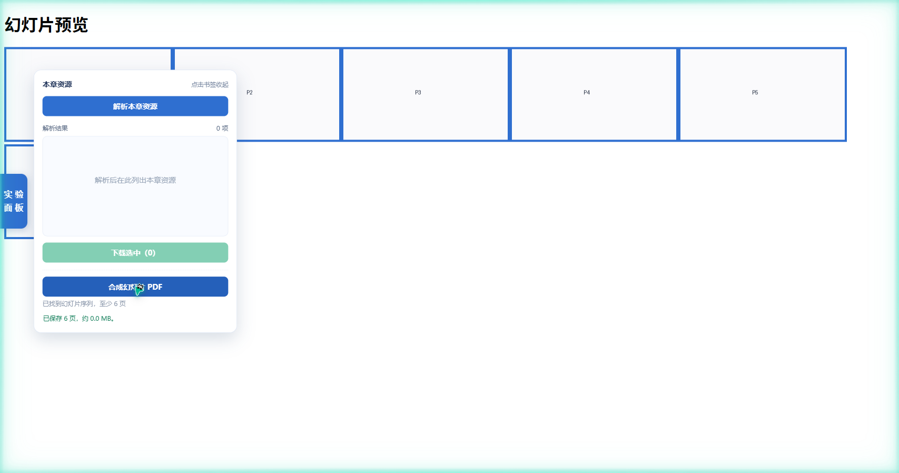

<h1 align="center">userscript-download-lab</h1>

<p align="center">一个用户脚本工程实验：适配器接口、与站点无关的下载引擎，以及一个用来跑实验的合成课程站点。</p>

<p align="center">
  <a href="README.zh-CN.md">简体中文</a> · <a href="README.md">English</a>
</p>

<p align="center">
  <a href="https://github.com/SunshineMahiru/userscript-download-lab/actions/workflows/test.yml"></a>
  <a href="CHANGELOG.md"></a>
  
  <a href="LICENSE"></a>
</p>

## 这是什么

一个用户脚本，把章节里的文档、视频、幻灯片图片序列解析出来，交给脚本管理器去下载。它关于某个站点的全部知识都放在一个小适配器里，引擎自己不知道站点长什么样。

仓库只带一个适配器，而且只匹配 `http://127.0.0.1/*`，也就是 `fixtures/` 里那个合成站点。没有任何真实平台的适配器。缺少适配器时引擎会明确报错并说明原因，不会静默失败。

重点在工程，不在工具。一份写清楚的接口定义、一套夹具驱动的测试、六篇能复跑出数字的实验记录，这三样是仓库的主要内容。

## 这不是什么

- 不连任何真实课程平台。仓库里没有出现任何真实站点的域名、接口、字段名或会话细节。
- 不解密、不合并分片、不绕访问控制。这些能力在接口里根本没留位置，不是留了没用。
- 不是下载管理器。一次处理一个章节，只取当前会话本来就能看到的东西。

## 几个具体的地方

- 适配器接口一共六个成员，五个必需一个可选，接口文档里写的和代码里做的是一回事。
- 传输层可注入。线上包住 `GM_xmlhttpRequest` 与 `GM_download`，测试里换成 `node:http`，请求真的打到本地服务器。没有为了让测试变绿而伪造行为。
- 83 条断言分在九个测试文件里，覆盖文件名规则、合成站点、引擎、页数探测、错误映射、面板、入口装配、打包产物，以及元数据。
- 界面文案中英两套，按浏览器语言选。
- 页数用指数加二分探测。1500 页的序列花 20 次请求，线性扫描要 1500 次。
- `docs/experiments/` 下有六篇记录，每篇都写明了复跑命令和跑出来的数字。
- [`docs/manual-check.md`](docs/manual-check.md) 是一份手工验收清单，覆盖只有真实脚本管理器才能回答的那部分。

## 结构

```text
┌──────────────────────────────┐
│  script manager (GM_*)       │
└──────────────┬───────────────┘
               │ host API
┌──────────────▼───────────────┐
│  panel · engine · adapter    │
└──────────────┬───────────────┘
               │ HTTP
┌──────────────▼───────────────┐
│  fixture site (serve.mjs)    │
└──────────────────────────────┘
```

引擎通过一个传输对象跟脚本管理器说话，通过适配器跟站点说话。适配器不发请求，也不碰 DOM，它只做两件事：把页面上下文变成地址，把响应变成资源记录。

合成站点是个普通的 `node:http` 服务，响应内容全部来自 `fixtures/site/*.json`，代码里没有业务数据。

## 上手

需要 Node 20 或更新的版本。测试里用到的 `jsdom` 与全局 `fetch` 都有这个下限。

```bash
git clone git@github.com:SunshineMahiru/userscript-download-lab.git
cd userscript-download-lab
npm ci
npm run serve          # 合成站点跑在 http://127.0.0.1:8080
npm run build          # 重新生成 userscript-download-lab.user.js
```

仓库里已经带了构建好的 `userscript-download-lab.user.js`，只有在改过 `src/` 之后才需要跑 `npm run build`。

把它装进支持 `GM_xmlhttpRequest` 与 `GM_download` 的管理器——Tampermonkey、ScriptCat、Violentmonkey 都行——然后打开 `http://127.0.0.1:8080/chapter/ch-1`。左侧会出现一个面板，点解析会列出五项资源，勾选后能下载，也能把幻灯片序列合成一份 PDF。

`serve` 和 `build` 开两个终端跑。服务默认监听 8080，设 `PORT` 可以换端口，脚本跟着走——匹配范围里本来就没有端口。

## 适配器接口

六个函数加一个能力声明。完整定义和数据结构在 [`docs/architecture.md`](docs/architecture.md)。

| 成员 | 职责 |
| --- | --- |
| `readChapter(context)` | 认出章节，不是章节页就返回 `null` |
| `listingRequest(chapter, cursor)` | 拼列表页的请求 |
| `parseListing(text, cursor)` | 把列表响应分成引用与下一页游标 |
| `statusRequest(chapter, ref)` | 拼单条资源的状态请求 |
| `parseStatus(payload, ref)` | 取出最终地址，取不到返回 `null` |
| `readSeries(context)` | 认出幻灯片序列，可选 |

接口里没有预留位。引擎驱动不了的东西就不写进来，所以文档和代码说的是同样六个函数。

## 测试

`npm test` 一条命令跑完九个文件。

| 文件 | 断言 | 覆盖 |
| --- | --- | --- |
| `filename.test.mjs` | 9 | 后缀判定、Windows 保留名、按字节截断 |
| `server.test.mjs` | 13 | 站点路由、302 签名、过期、页数越界、预览页 |
| `engine.test.mjs` | 9 | 分页、取址、批量下载、序列识别、能力校验 |
| `slides.test.mjs` | 9 | 地址拼接、探测次数、真实重编码、PDF 页面尺寸 |
| `errors.test.mjs` | 11 | 状态码归一、管理器回调、缺失能力 |
| `panel.test.mjs` | 14 | 渲染、转义、勾选状态、拖拽、中英两套文案 |
| `boot.test.mjs` | 5 | 入口装配，注入宿主接口后跑通整条链 |
| `bundle.test.mjs` | 4 | 直接执行构建好的产物，而不是源码 |
| `artifact.test.mjs` | 9 | 元数据、与源码逐字节同步、版本一致、禁用词 |

产物那条测试会重新构建一次，再跟仓库里的文件逐字节比对。改了源码忘记重建，测试直接失败。CI 在每次推送和 PR 时跑 `npm ci` 与 `npm test`。

## 真机验证

上面那套测试跑在 Node 里，回答不了「装进真实脚本管理器还能不能用」——管理器把它自己的接口注入到一个 Node 没有的作用域里。这七张截图来自 Chrome + Tampermonkey 5.5.0 对本合成站点的实测，未经裁剪。

有四个缺陷只在真机上暴露：`GM_*` 不在 `window` 也不在 `globalThis` 上、`GM_download` 查 `@connect` 而同源 `GM_xmlhttpRequest` 不查、相对地址的跳转会让主机校验失效、管理器对 4xx 返回的是状态短语而不是内部码。四个都已修，各有回归测试或在 [`docs/manual-check.md`](docs/manual-check.md) 里留了记录。

**1. 面板挂载**

<p align="center"></p>

**2. 解析出五项资源**

<p align="center"></p>

**3. 按钮跟着勾选变，计数不跟着变**

<p align="center"></p>

**4. 批量下载记录失败但不中断**

<p align="center"></p>

**5. 序列在点击之前就已被识别**

<p align="center"></p>

**6. 六张幻灯片合成一份 PDF**

<p align="center"></p>

**7. 非章节页会明说**

<p align="center"></p>

## 实验记录

| 篇目 | 结果 |
| --- | --- |
| `01-page-counting.md` | 1500 页 20 次探测，线性要 1500 次 |
| `02-pdf-page-geometry.md` | 固定 960 pt 宽，`/MediaBox` 实测 960×720 与 960×1920 |
| `03-filename-boundaries.md` | 保留名、结尾点、168 字节上限，比文件系统上限留出余量 |
| `04-error-code-taxonomy.md` | 四类错误来源，十四种码已被测试触发，其余逐条列出未覆盖原因 |
| `05-signed-url-redirect.md` | 302 进签名地址，篡改与过期返回不同的 403 响应体 |
| `06-cursor-pagination.md` | 五项引用用两次请求，请求次数也进断言 |

每篇的数据都来自合成站点或本地计算，记录里写明了来源。

## 目录

```text
src/          引擎、适配器、面板、幻灯片、传输层、文件名、错误、请求、内联解析、元数据、入口
fixtures/     合成站点的数据与幻灯片图片
tools/        站点服务器、打包脚本、测试用传输层
tests/        九个测试文件与共享的 jsdom 辅助
docs/         接口文档、决策记录、实验记录、手工验收清单
```

`docs/PROJECT.md` 与 `docs/repositioning.md` 是工作笔记，不进仓库。

## 许可证

MIT，见 [LICENSE](LICENSE)。
